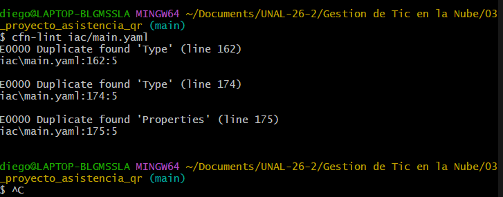
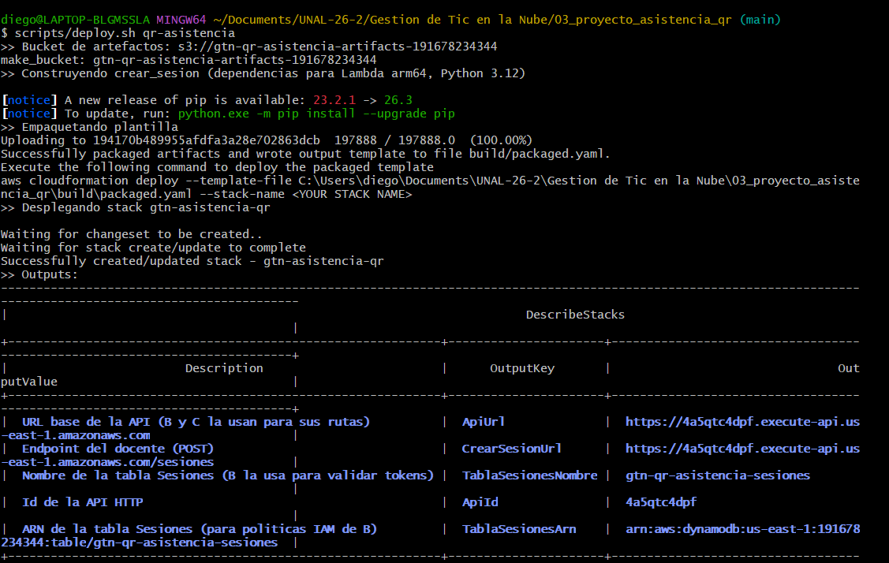
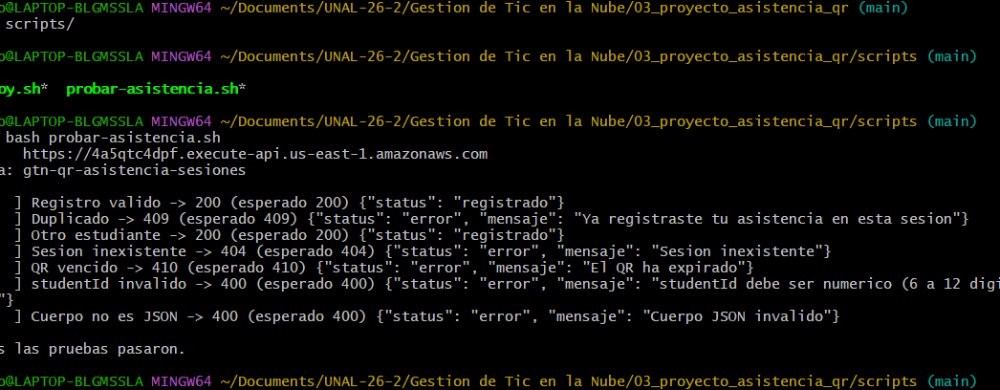

# Evidencias
Aquí van las evidencias de laboratorios (lab01–lab06) e hitos: capturas (PNG con nombre claro, p.ej. `lab05-stack-create.png`) y notas. El video de respaldo de la sustentación (2 min) también vive aquí.

Se ejecutó `cfn-lint` sobre la plantilla de infraestructura. La salida muestra errores por tipos o propiedades duplicadas en la sección de asistencia, que permitieron identificar las líneas que debían corregirse antes del despliegue.

Se creó el bucket de artefactos, se empaquetó la plantilla, se desplegó el stack de CloudFormation y se verificaron los recursos de salida, incluyendo la URL base de la API, las rutas del servicio y los identificadores de los recursos DynamoDB.

Se probaron los casos de la operación de asistencia con solicitudes HTTP. Las respuestas confirmaron el registro válido, la detección de asistencias duplicadas, la sesión inexistente, el `studentId` inválido y la validación de cuerpos JSON, y todas las pruebas finalizaron correctamente.